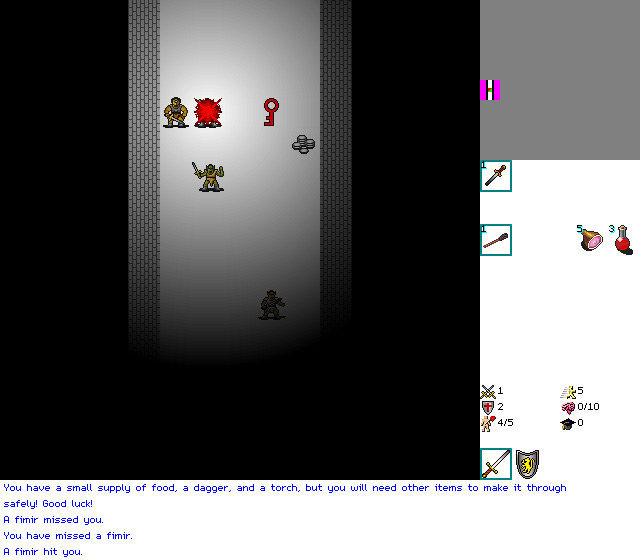

# HamQuest is back, and it runs in your browser

*October 11, 2026*

HamQuest was a C# game I wrote between 2007 and 2011: a WinForms app first, then a Silverlight version, then a WPF port that I abandoned. Silverlight is gone and the rest only ever ran on a Windows machine, so for years the game has just sat in a repository where nobody could play it. This week I rebuilt it in Odin, compiled to WebAssembly, and it now runs on this page.

## What it is

A turn-based maze crawl on an eight by eight grid of rooms. Dead ends are locked, the matching keys are lying around, there are shops, hidden traps, light that burns down and armour that slows you. You need sixteen pieces of the MegaHam and a Rainbow Key to leave. You start with five hit points. It is not kind.

## How it was made

I did this one with Claude Code, in a couple of sessions: I told it what the game was and made the decisions, and it read the old C#, wrote the Odin, and tested it. The page says so, because every page that used AI should.

The interesting parts, in case you like that sort of thing:

- **The game data stayed data.** The old game kept its items, creatures and messages in about 180 XML files. A script turns them into Odin tables at build time, and it is strict: a typo in a property name is an error, not a silent zero.
- **Strictness found real bugs in the original.** A minotaur whose defence was a number instead of a name (hit one and the old game would have crashed). Twenty messages the game asks for that were never written, so the log would have printed things like `NeedRainbowKey`. And shopping, which was free: the price was read as the wrong type, the error was swallowed, and it quietly charged nothing. Those are fixed. The prices are real now.
- **The same code runs in the page and in a native window.** The game core has no idea what a browser is. A test plays the same keys through the native build and the WebAssembly build and checks that every frame is identical, pixel for pixel.
- **Saves are replays.** The game is deterministic, so a save is the world seed plus the list of what you did, a few hundred bytes. Loading replays it. It is also why a save from one version of the rules is refused by the next one: it would be a different game.

## What I did not change

The difficulty. I wanted to know if it was a port bug that a new character dies so quickly. It is not: that is how the game always was. You are meant to avoid things, find boots, find armour, and eat a lot of ham.

## Controls and credits

Arrow keys or WASD to move, Space to rest, Tab to switch attack and defend gear, `C` for the credits. The page has the rest, and the touch controls appear on a phone.

The tiles are David Gervais's Angband 32x32 set (CC BY 3.0); the doors and walls are mine. The font is m5x7 by Daniel Linssen.

There is no sound yet. The old sound effects are not credited anywhere, so they stay out until they are.

## What is next

Real playtesting. If something feels broken, or too cruel even by this game's standards, tell me in the comments.
