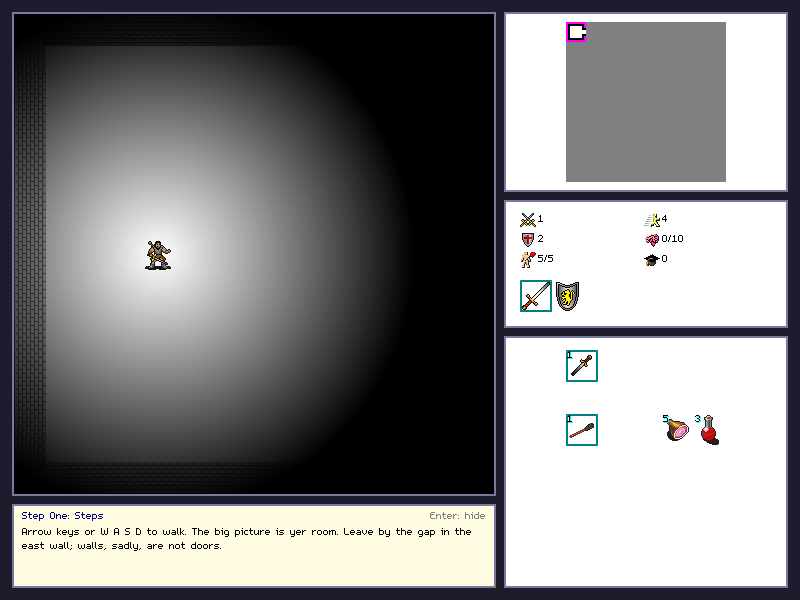

# HamQuest now has a tutorial, a menu and room to breathe

*October 12, 2026*

Last time I said real playtesting was next. The first thing playtesting told me is what I already knew: HamQuest is a game where yer first death comes before yer first idea of what the little pictures on the right are for. So this update is about getting a new player to the second death with some idea what is going on.

## The tutorial

There is a title menu now, and it has **Tutorial** on it. It is a hand-built training cellar of thirteen rooms, made out of the real rooms, items and monsters, so everything you learn there is true in the real game: how to read the minimap, what is in the pack, how a fight works, that a locked door wants a key of its own colour, what a shop wants, why a torch matters, and what a row of hidden traps is for.

A few decisions I made on purpose:

- **You cannot die in it.** A blow that would have killed you puts you back at the door of the room, the monsters start over, the hams and potions are topped up, and the game tells you what would have happened. The tutorial is for learning the rules, not for being punished by them. The real game is unchanged.
- **It shows the lesson of the room yer standing in, not a fixed sequence.** Skip a lesson, wander off, come back: it points yer way ("Head east to find the shoppe") instead of getting stuck.
- **The log wins.** Early on, the lesson sat on top of the combat messages and you could only see the red hit marks. Now anything new in the message log takes the box back from the lesson. H, or a tap on the box, brings the lesson back.
- **It leaves yer game alone.** The tutorial is not saved, and yer real game stays exactly where it was. There is a "Return to yer game" on the menu while you are in it.
- **No reward.** You finish it, you are told the real dungeon is less polite, and that is it.

## Everything got a border

The screen was far too tight: the map, the minimap, the pack and the messages were packed edge to edge, with nowhere to put a lesson. The picture is bigger now (800 by 600) and every part has its own bordered box and some room around it. Long messages wrap instead of running off the side.

## One more thing: "yer"

Everything the game says now says "yer" and nothing else. It was supposed to all along. The original messages have been rewritten by one rule, so "Yer torch has gone out" is how it reads, and a test fails if the other word ever sneaks back in.

## Still true

The difficulty has not been changed, there is still no sound, and the tiles are David Gervais's Angband 32x32 set (CC BY 3.0). If the tutorial gets something wrong, or a lesson is boring, say so in the comments.
